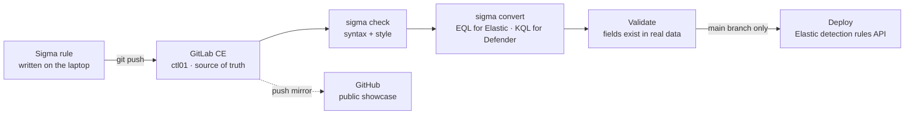
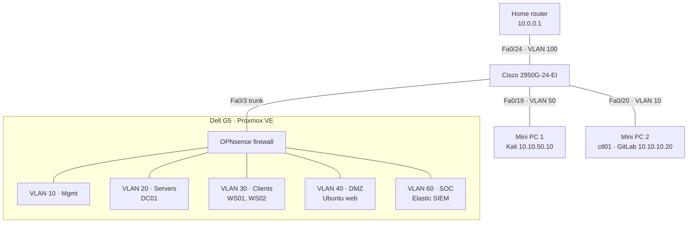

# Detection Engineering Lab

A segmented, Microsoft-style business network built on a single node Proxmox hypervisor, used to emulate attacks, collect telemetry in Elastic Security, and build detections as code (Sigma, Elastic rules,CI/CD).

**Status:** 🟡 Build phase. Network, firewall, Active Directory, Elastic SIEM with Windows telemetry, and the first detection (Scenario 001) are done. The detection-as-code pipeline lints and converts every rule, GitLab mirrors `main` to GitHub, and Scenario 001 went through it twice: revision 2 revealed a bypass in the common `-Encoding` exclusion, revision 3 closed it without any exclusion. Next: a deploy stage to Kibana. SIEM switched from Wazuh to Elastic ([why](docs/2026-10-20-why-elastic-over-wazuh.md)).

## Goals

- **Detection engineering:** emulate ATT&CK techniques, capture telemetry, write and validate detections, document false positives and gaps.
- **Networking:** VLAN design, 802.1Q trunking, switch hardening, firewall policy with written rationale.
- **Systems:** Proxmox, Windows Server Active Directory, Group Policy, Windows 11, Linux.
- **Detection as code (CI/CD):** detections live in a self-hosted GitLab and ship through a pipeline that lints, converts, validates and deploys them. No rule reaches the SIEM by hand.
- **Infrastructure as code:** Terraform builds VMs on Proxmox and Ansible configures them, so any part of the lab can be rebuilt from the repo.

## Detection-as-code pipeline

🚧 Built: `sigma check` lint gate → automatic EQL/KQL conversion → GitHub push mirror. Not built yet: validate and deploy to Kibana.



- **GitLab is the source of truth.** Every change goes through GitLab, and its CI runner sits inside the lab, next to the SIEM it deploys to.
- **GitHub is a read-only mirror.** GitLab pushes to it automatically, so this public repo always matches what's actually deployed. Nothing is edited on GitHub.
- **Validation exists because of a real mistake.** In [Scenario 001](scenarios/001-powershell-encoded-command/README.md), I edited a converted rule because I assumed one of its fields was missing from my data. It wasn't. The pipeline checks converted queries against real data, so assumptions like that get tested instead of guessed.

## Hardware

| Device | Specs | Role |
| --- | --- | --- |
| Dell G5 5000 | i5-10400F (6c/12t), 32 GB RAM, 2 x ~476 GB SSD | Proxmox VE hypervisor |
| Lenovo ThinkCentre (mini PC 1) | i3-4130T, 8 GB RAM | Kali Linux attacker (bare metal) |
| Lenovo ThinkCentre (mini PC 2) | i3-4130T, 8 GB RAM | Control node `ctl01`: GitLab CE (running), CI runner, Terraform + Ansible (planned) |
| Cisco WS-C2950G-24-EI | 24 x 100 Mbps, 2 x GBIC slots (1000BASE-SX installed) | Core switch, 802.1Q trunk |

## Architecture



OPNsense is the only path between zones, with default deny between every zone. Every cross-zone move an attacker makes lands in firewall logs.

Detailed diagrams of the bridge, VLAN tagging and traffic flows: [virtual network](docs/virtual-network.md).

| VLAN | Name | Subnet | Hosts |
| --- | --- | --- | --- |
| 100 | Home | 10.0.0.0/24 | Proxmox mgmt .90, OPNsense WAN .91 |
| 10 | Mgmt | 10.10.10.0/24 | Switch SVI, OPNsense admin, `ctl01` `.20` (GitLab, mini PC 2) |
| 20 | Servers | 10.10.20.0/24 | DC01 (`cybereli.local`) |
| 30 | Clients | 10.10.30.0/24 | WS01 `.21`, WS02 `.22` (domain-joined, reserved DHCP) |
| 40 | DMZ | 10.10.40.0/24 | Ubuntu web target |
| 50 | Attacker | 10.10.50.0/24 | Kali `10.10.50.10` (mini PC 1) |
| 60 | SOC | 10.10.60.0/24 | Elastic SIEM (VM) |
| 999 | Dead | none | Trunk native VLAN, unused ports |

## Repository layout

```
├── README.md
├── .gitlab-ci.yml            detection-as-code pipeline (planned)
├── 00-build/                 hypervisor install, storage, ISO hashes, build log
├── 01-network/               switch config, OPNsense, firewall rules + rationale
├── 02-active-directory/      domain build, GPOs, intentional misconfigurations
├── 03-logging/               Sysmon, audit policy, Elastic Agent + Fleet policies
├── detections/
│   ├── sigma/                source of truth
│   ├── elastic/              generated Elastic detection rules
│   ├── kql/                  generated from Sigma
│   └── yara/
├── scenarios/                one folder per attack → detect write-up
├── coverage/                 ATT&CK Navigator layer
├── infra/                    Terraform (Proxmox VMs) + Ansible (configuration) (planned)
└── docs/                     design decisions
```

## Progress

- [x] Architecture and VLAN design ([design decisions](docs/design-decisions.md))
- [x] SIEM evaluation: Wazuh installed, replaced by Elastic ([write-up](docs/2026-10-20-why-elastic-over-wazuh.md))
- [x] Proxmox installer USB
- [x] Proxmox VE on the G5 ([build log](00-build/build-log.md))
- [x] Elastic SIEM VM: Elasticsearch 9.5.5 + Kibana on `elastic01`
- [x] Fleet Server
- [x] Disk health and `vm-lab` storage pool
- [x] Switch trunk and VLAN-aware bridge
- [x] OPNsense, VLAN interfaces, DHCP (verified per VLAN)
- [x] Firewall baseline on every zone
- [x] Switch hardening ([switch config](01-network/switch-config.md))
- [x] DC01 built, networked, eval activated
- [x] DC01 promoted: `cybereli.local`
- [x] WS01 built and tested (Windows 11 Enterprise eval)
- [x] Windows 11 template (sysprep), WS02 cloned, both clients domain-joined
- [x] Sysmon and Elastic Agent on DC01, WS01, WS02 (all Healthy)
- [x] Audit policy GPO + PowerShell logging (4688 and 4104 verified)
- [x] Scenario 001: [PowerShell with an encoded command](scenarios/001-powershell-encoded-command/README.md)
- [x] Kali on mini PC 1, attacker zone verified
- [x] Control node `ctl01` + GitLab CE ([build log](00-build/2026-11-02/log.md))
- [x] GitLab Runner on `ctl01`, first pipeline passed ([build log](00-build/2026-11-04/log.md))
- [x] Push mirror to GitHub; lint and convert stages ([build log](00-build/2026-11-04/log.md))
- [ ] Deploy stage to Kibana, drift check
- [ ] DMZ target

## License

| Content | License | In short |
| --- | --- | --- |
| Detection rules ([`detections/`](detections/)) | [Detection Rule License 1.1](detections/LICENSE.md) | Use, modify and deploy them freely, commercially too. Keep the author attribution in the rule and in alerts it generates. |
| Everything else: build logs, write-ups, docs, diagrams | [CC BY 4.0](LICENSE) | Reuse and adapt with credit to Eli ([Elimartes15](https://github.com/Elimartes15)). |

Rules adapted from [SigmaHQ](https://github.com/SigmaHQ/sigma) keep their original authors' attribution through each rule's `related` and `references` fields, as DRL 1.1 requires.
