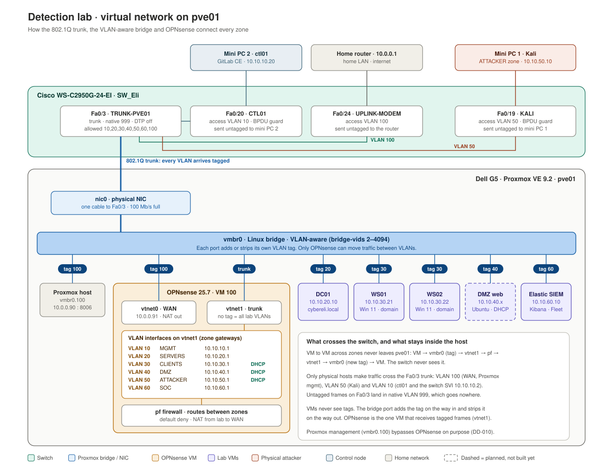
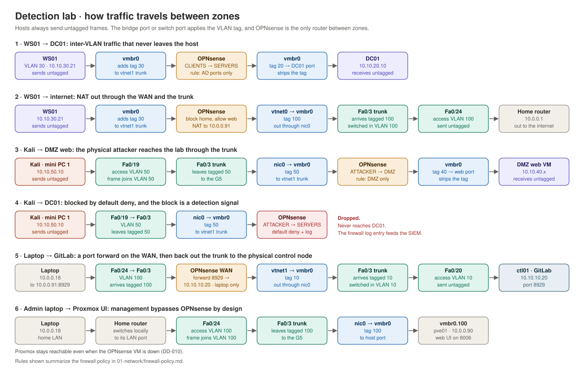

# Virtual Network

How traffic moves through pve01: the 802.1Q trunk from the switch, the VLAN-aware bridge `vmbr0`, and OPNsense as the only router between zones.

## Topology

- **One cable, every VLAN.** Fa0/3 is an 802.1Q trunk to the G5's single NIC (`nic0`). Native VLAN is 999, so untagged frames go nowhere.
- **The bridge does the tagging.** Each VM port on `vmbr0` has a VLAN tag. The bridge adds it on the way in and strips it on the way out, so VMs never see tags.
- **OPNsense is the only path between zones.** Its `vtnet1` NIC has no tag, so it receives every lab VLAN tagged and splits them into VLAN interfaces (`10.10.X.1`). Its `vtnet0` NIC is tagged 100 and is the WAN.
- **Management stays out of the firewall.** Proxmox management (`vmbr0.100`, `10.0.0.90`) sits on the home VLAN directly, so a broken OPNsense VM can't lock me out of the hypervisor (DD-010).

## Traffic flows

| # | Flow | Crosses the switch? | Through OPNsense? |
| --- | --- | --- | --- |
| 1 | WS01 → DC01 | No, stays inside pve01 | Yes, CLIENTS → SERVERS |
| 2 | WS01 → internet | Yes, as VLAN 100 | Yes, NAT to `10.0.0.91` |
| 3 | Kali → DMZ web | Yes, as VLAN 50 | Yes, ATTACKER → DMZ |
| 4 | Kali → DC01 | Yes, as VLAN 50 | Dropped by default deny and logged |
| 5 | Laptop → Proxmox UI | Yes, as VLAN 100 | No, by design |

**Why it matters for detection:** every cross-zone move (flows 1–4) passes through OPNsense, so every attempt, allowed or blocked, leaves a firewall log entry the SIEM can alert on. Flow 4 is the kind of event a lateral-movement detection keys on.

The rules shown in the flows are the planned policy. The firewall rules themselves are the next build step.
