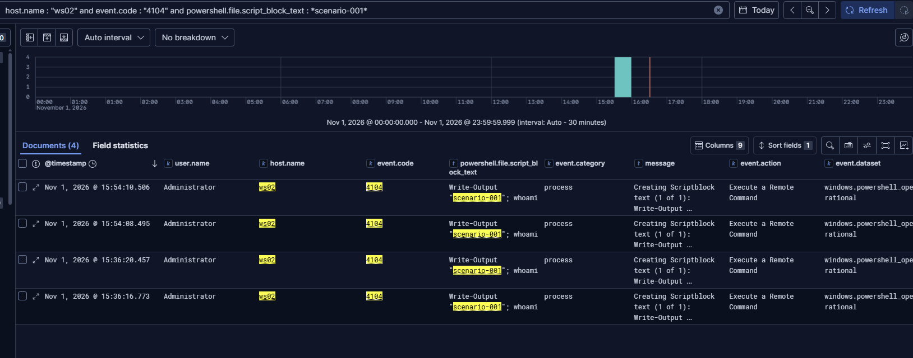
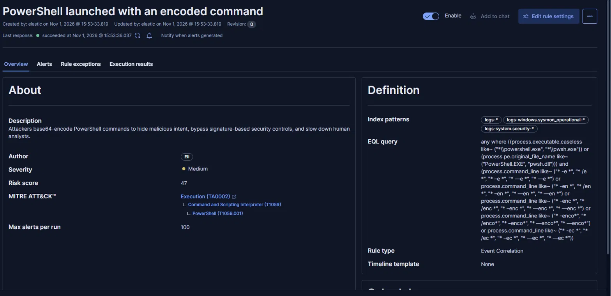
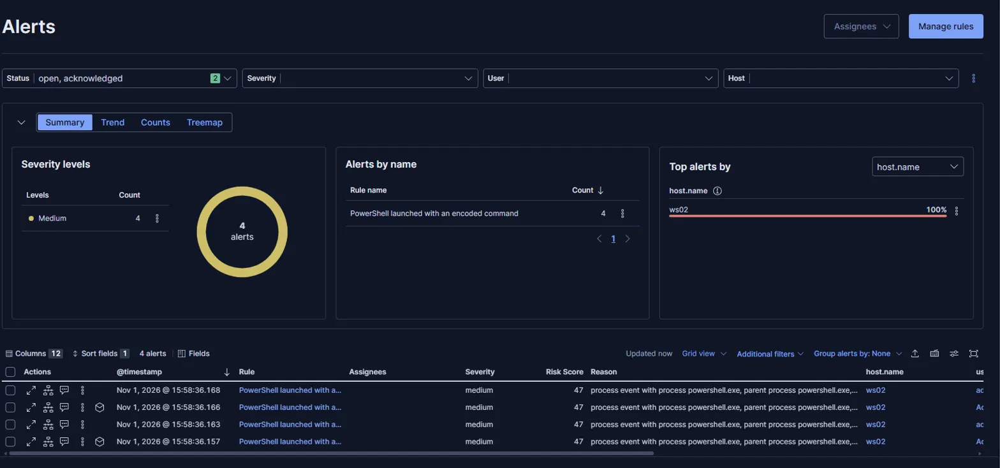
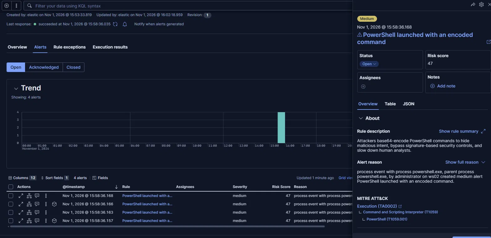
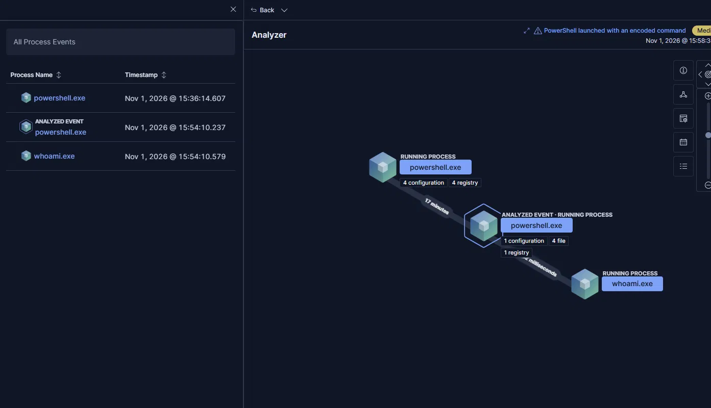
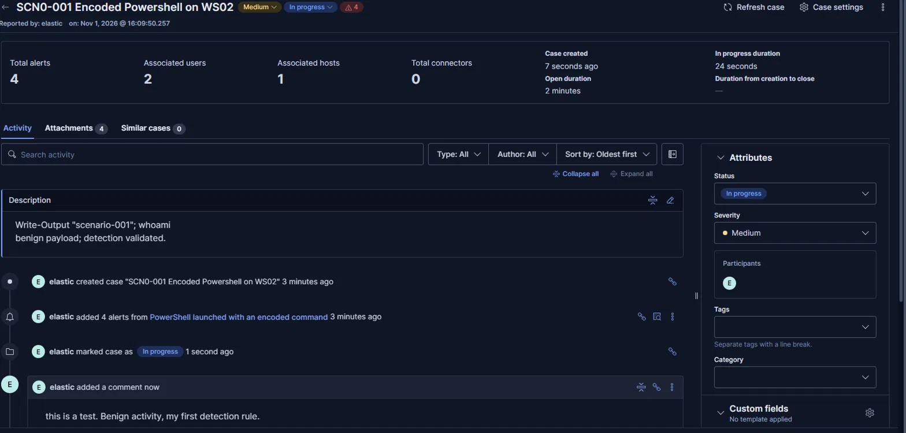

# Scenario 001 · PowerShell Launched With an Encoded Command

| | |
| --- | --- |
| **Date** | 2026-11-01 |
| **MITRE ATT&CK** | [T1059.001 PowerShell](https://attack.mitre.org/techniques/T1059/001/) (Execution) · [T1027 Obfuscated Files or Information](https://attack.mitre.org/techniques/T1027/) (Defense Evasion) |
| **Target** | WS02 (Windows 11 Enterprise, `cybereli.local`) |
| **Data sources** | Sysmon Event ID 1, Windows Security 4688, PowerShell Operational 4104 |
| **Detection** | [Sigma](../../detections/sigma/windows/process_creation/proc_creation_win_powershell_encoded_command.yml) · [Elastic EQL](../../detections/elastic/proc_creation_win_powershell_encoded_command.eql) · [Microsoft Defender KQL](../../detections/kql/proc_creation_win_powershell_encoded_command.kql) |
| **Result** | Detected. 4 alerts (2 runs × 2 sources), triaged in a case |

## Hypothesis

Attackers Base64-encode PowerShell commands (`-EncodedCommand`) so the real instructions never appear in plain text on the command line. That hides them from casual review and from simple keyword filters. Legitimate interactive use of encoded commands is rare, so **a PowerShell process started with `-EncodedCommand` or any of its abbreviations is worth an alert**, and script block logging should reveal what was actually run.

## Emulation

A benign payload, launched the way an attacker would launch a real one:

```powershell
$cmd = 'Write-Output "scenario-001"; whoami'
$b64 = [Convert]::ToBase64String([Text.Encoding]::Unicode.GetBytes($cmd))
powershell.exe -NoProfile -EncodedCommand $b64
powershell.exe -NoProfile -enc $b64
```

Two runs: the full parameter name, and the short `-enc` form attackers commonly use. The payload only prints a line and runs `whoami` (itself a discovery technique, T1033).

## Telemetry

The same action, seen from three independent sources:

| Source | Event | What it shows |
| --- | --- | --- |
| Sysmon | Event ID 1 (process creation) | `powershell.exe` with the Base64 blob in `process.command_line`, its parent process, and process GUIDs that link parent to child |
| Windows Security | 4688 (process creation) | The same launch and command line, independently of Sysmon |
| PowerShell Operational | 4104 (script block) | **The decoded command**: `Write-Output "scenario-001"; whoami` |



**The encoding hid nothing.** PowerShell has to decode a command before running it, and script block logging records the decoded version.

## Detection logic

Match a PowerShell binary, identified by path **or** by its original file name (so a renamed copy is still caught in Sysmon data), whose command line contains the encoded-command parameter or any abbreviation PowerShell accepts: `-e`, `-en`, `-enc`, `-enco…`, `-ec`. The `windash` modifier also covers `/` and Unicode dash variants.

- **Sigma** is the source of truth, converted with pySigma (`ecs_windows` pipeline) to **EQL** for Elastic and to **KQL** for Microsoft Defender (`DeviceProcessEvents`).
- **EQL** was chosen over Lucene because its `like~` operator is **case-insensitive**: `-ENC`, `-Enc` and `-enc` all match. Attackers vary case to evade case-sensitive string matches.
- Elastic rule: Event Correlation (EQL), index patterns `logs-windows.sysmon_operational-*` and `logs-system.security-*`, every 5 minutes, severity Medium, risk score 47.



*Revision 0, before the fix: it still has the `.caseless` field and the `logs-*` index pattern (see [lessons learned](#lessons-learned)). Revision 1 replaced both.*

## Validation

Re-running the emulation produced **4 alerts**: 2 runs × 2 sources (Sysmon and Security log).



The alert reason reads: *process event with process powershell.exe, parent process powershell.exe, by administrator on ws02*.



Elastic's **Analyzer** rebuilt the process tree from Sysmon's process GUIDs:

```
powershell.exe               (interactive session)
  └─ powershell.exe -EncodedCommand …    ← alerted event
       └─ whoami.exe   342 ms later      ← the decoded payload running
```



The tree shows cause and effect without decoding anything: the encoded command spawned `whoami.exe` within milliseconds, machine speed rather than a person typing. In a real incident the top node is the story: `WINWORD.EXE` or `OUTLOOK.EXE` there would mean a malicious document.

The alerts were attached to case **SCN-001**, annotated with the decoded command, and handled as a test true positive.



## Tuning and false positives

- **Duplicate alerts:** each execution alerts twice, once per source. Kept deliberately: if an attacker unloads the Sysmon driver, the Security-log alert still fires. Elastic's alert suppression could merge them, but it isn't available on the free license.
- **Only Sysmon alerts open in the Analyzer.** 4688 events carry no process GUIDs. Sysmon provides context; 4688 provides resilience.
- **Likely false positives:** management and deployment tools that pass scripts as encoded commands (SCCM, Intune, some installers). None seen in the lab yet; in production, baseline for a week and add exceptions by parent process and signer, not by command line.
- **Inconsistent user names across sources:** the same account appears as `administrator` in one source and `Administrator` in the other, so the case counted 2 associated users for 1 account. Queries and correlations on `user.name` should be case-insensitive.

## Gaps

| Evasion | Covered? | Next step |
| --- | --- | --- |
| Case variations (`-ENC`) | Yes, EQL `like~` | — |
| Renamed `powershell.exe` | Sysmon: yes (`OriginalFileName`). 4688: no | Accept; Sysmon covers it |
| PowerShell hosted inside another program (no `powershell.exe` at all) | No | **A 4104-based rule**: script block logging records the code regardless of the host process |
| Payload passed another way (download cradle, `-Command` with obfuscation) | No | Separate rules for obfuscation patterns in 4104 |

## Lessons learned

1. **Converted rules must be validated against real data.** The automated conversion used `process.executable.caseless`, a field that exists in Elastic Defend's data but not in Windows integration data. With it, the 4688 half of the rule could never match. Caught by testing against real events; it's why the CI pipeline needs a validation step.
2. **Discover doesn't run EQL.** Discover's search bar accepts KQL and Lucene only; EQL is tested in the rule preview or a Timeline's Correlation tab.
3. **Scope rules to the data they need.** The rule first included `logs-*`, which searches every data stream in the cluster; narrowed to the two relevant patterns.
4. **Two sources are worth the duplicates.** One gives context (process tree), the other resilience.
